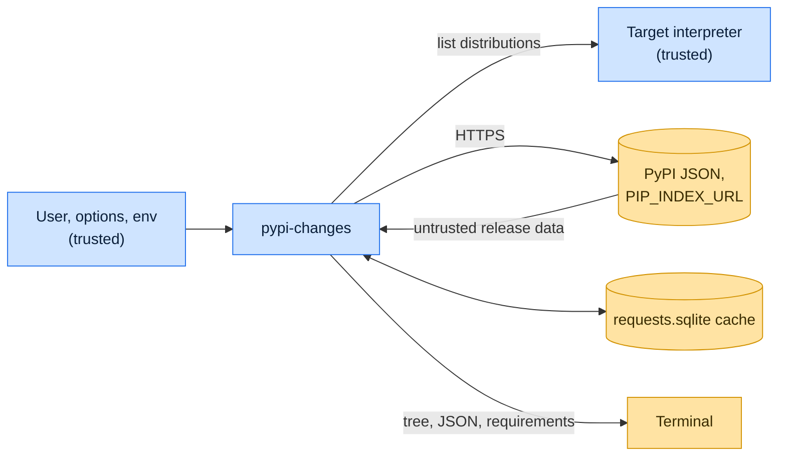

# Threat model

This model says what pypi-changes trusts, where untrusted input enters, and which guarantees hold at each boundary, so a
report can be classified as a vulnerability or a bug. [SECURITY.md](SECURITY.md) covers reporting; if the two disagree,
SECURITY.md wins and we fix this file.

## How pypi-changes works

pypi-changes runs the target interpreter only to read its `sys.path`, reads the distribution metadata found there, then
asks PyPI's JSON API (and the simple index named by `PIP_INDEX_URL`, when it is not PyPI) for each package's releases.
Answers are cached in a SQLite file under the user cache directory for `--cache-duration` seconds (`0` bypasses the
cache, `-1` keeps answers forever). It prints a tree with release ages and major-version jumps, or JSON or a
requirements list.

## Compared with similar tools

We drew the boundary where comparable projects in other ecosystems draw theirs. The shared rule, stated by the
[Node.js threat model](https://github.com/nodejs/node/blob/main/SECURITY.md#the-nodejs-threat-model), is that a report
which first needs a trusted element compromised is out of scope; the first triage question, as
[DOMPurify](https://github.com/cure53/DOMPurify/blob/main/SECURITY.md#what-we-consider-a-vulnerability) puts it, is what
the attacker controls.

| Project                                                                           | Language   | Where it draws the line                                                                                                                                                  |
| --------------------------------------------------------------------------------- | ---------- | ------------------------------------------------------------------------------------------------------------------------------------------------------------------------ |
| [npm CLI](https://github.com/npm/cli/security/policy)                             | JavaScript | Follows GitHub's open source reporting policy, which defines no scope of its own.                                                                                        |
| [Cargo (`cargo outdated` ecosystem)](https://www.rust-lang.org/policies/security) | Rust       | The Rust toolchain, Cargo included, assumes the user's code and dependencies are trusted; compiling or analyzing a malicious project is out of scope.                    |
| [pnpm](https://github.com/pnpm/pnpm/security/policy)                              | JavaScript | Draws its boundary at filesystem permissions: the store, project, lockfile and configuration are trusted, and running it in a repository means trusting that repository. |

## Trusted

An attacker who controls any of these already has what pypi-changes could give them:

- The user, the target interpreter and its installed distributions.
- `PIP_INDEX_URL` and the cache path and duration options.

## Untrusted inputs

| Input                                | Comes from                       | What pypi-changes guarantees                                                                   |
| ------------------------------------ | -------------------------------- | ---------------------------------------------------------------------------------------------- |
| Release data from PyPI and the index | Anyone who can publish a package | Shown as text: names are rich `Text`, not markup; JSON output is serialized, not concatenated. |
| The cache file                       | Earlier runs                     | Expired entries are deleted on start.                                                          |

## Threats and controls

| STRIDE                 | Threat                                                           | Control                                                                                  |
| ---------------------- | ---------------------------------------------------------------- | ---------------------------------------------------------------------------------------- |
| Tampering              | A crafted release field injects rich markup or terminal escapes. | Names are rendered as `Text` objects; report any escape that reaches the terminal.       |
| Information disclosure | Index credentials end up in the cache file.                      | Accepted risk: the cache stores what the session requested, in the user cache directory. |

## Release chain

Releases run on the shared [tox-dev/github-workflows](https://github.com/tox-dev/github-workflows) pipeline. A release
App, not a person, pushes the release commit and tag; the build installs its tools from a hash-checked `pylock.toml`
resolved with a seven-day upload cooldown by default; PyPI receives the files through
[trusted publishing](https://docs.pypi.org/trusted-publishers/) with attestations, and the GitHub Release is immutable.
Every workflow pins third-party actions to a commit SHA.

## Vulnerability or bug

| Report                                                           | Verdict             | Why                                                   |
| ---------------------------------------------------------------- | ------------------- | ----------------------------------------------------- |
| A package's release data with `\x1b]0;...` retitles the terminal | Vulnerability       | Untrusted data reached the terminal as control codes. |
| pypi-changes runs the interpreter it was given                   | Not a vulnerability | The interpreter is trusted.                           |
| A release shows the wrong age                                    | Bug                 | Correctness only.                                     |

## Severity

- **High:** release data breaks out of its field in the JSON or requirements output, or requests go to a host other than
  PyPI and the configured index.
- **Medium:** release data changes the terminal through control sequences, or a write lands outside the cache file.
- **Low:** a crash on malformed release data instead of skipping it.

## Accepted risks

- Responses, including requests to a credentialed `PIP_INDEX_URL`, are cached in a SQLite file under the user cache
  directory with default permissions.

## Keeping this current

Revisit this model when pypi-changes gains a new input source, network access, a new way to run code, or a new place it
writes to, and whenever an advisory is published.
